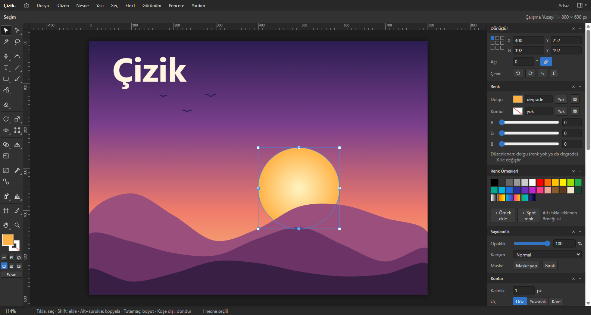

# Çizik

**Windows için ücretsiz vektör çizim uygulaması.** Logo, afiş, ikon ve baskı işleri için; Türkçe arayüzlü, hesap istemez, internete bağlanmaz.

## İndir

En son sürümü **[Sürümler (Releases)](../../releases/latest)** sayfasından indir:

- **Cizik-Kurulum-x.y.z.exe**: normal kurulum (Başlat menüsüne ve masaüstüne kısayol ekler)
- **Cizik-Tasinabilir-x.y.z.exe**: kurulum gerektirmez, USB bellekten de çalışır

**Virüs taraması:** Kurulum dosyası 1.8.2, VirusTotal'da 65 antivirüs ile tarandı, hiçbiri sorun bulmadı (0/65). [Tarama sonucunu gör](https://www.virustotal.com/gui/file/52f97c6674fe127b169854d8f6c512511a3898aa310abbac05131b8029d31447)

> **"Windows bilgisayarınızı korudu" uyarısı çıkarsa:** Çizik henüz dijital olarak imzalanmadığı için Windows tanımadığı programlarda bu uyarıyı gösterir. **Ek bilgi → Yine de çalıştır** ile açabilirsin.

Gereksinim: Windows 10 veya 11, 64 bit.

## Neler yapabilir?

**Çizim**
- 87 araç: kalem, eğrilik, şekiller, fırçalar, şekil oluşturucu, genişlik, bükme, perspektif ızgarası, kesme, silgi ve daha fazlası
- Katmanlar, çalışma yüzeyleri, kılavuzlar, cetveller, akıllı kılavuzlar
- Yol bulucu (birleştir, çıkar, kesiştir…), hizalama, dönüştürme
- Efektler, degradeler, saydamlık ve karışım modları, maskeler

**Canlı özellikler**
- **Canlı karışım:** iki şekil arasında geçiş; şekilleri değiştirince karışım kendini yeniler, bir yola da hizalanabilir
- **Canlı boya:** kesişen çizgilerin oluşturduğu bölgeleri ve kenarları kova ile tek tek boya; küçük boşluklar kapalı sayılır
- **Semboller:** bir kez çiz, istediğin kadar kullan; sembolü düzenleyince bütün kopyalar değişir. 9 dilimli ölçekleme ve dinamik semboller
- **Yalıtım modu:** gruba çift tıkla, yalnız içini düzenle

**Yazı**
- Nokta ve alan yazısı, yol üstünde yazı
- **Anahat oluşturma:** yazıyı gerçek yazı tipi şekilleriyle çizgiye çevirir (bitişik harfler ve değişken yazı tipleri dahil)

**Baskı**
- CMYK ve spot (Pantone benzeri özel) renkler
- ICC renk profilleri, üst baskı (overprint) ve ayrımlar önizlemesi
- PDF çıktısında gerçek CMYK ve spot renk kanalları

## Dosya türleri

| Tür | Açma | Kaydetme |
|---|---|---|
| Çizik belgesi (.cizik) | ✔ | ✔ |
| SVG | ✔ | ✔ |
| PDF | ✔ | ✔ |
| Adobe Illustrator (.ai) | ✔ (katmanlarıyla) | ✔ (PDF tabanlı) |
| EPS / PS | ✔ | ✔ |
| PNG, JPEG, WEBP | yerleştirme | ✔ (dışa aktarma) |

Çizik ile kaydedilen PDF, AI ve EPS dosyaları yeniden açıldığında katmanları ve düzenlenebilirliği korunur.

## Gizlilik

Çizik internete bağlanmaz, hesap istemez, hiçbir veri toplamaz ve göndermez. Belgelerin yalnız senin bilgisayarında kalır.

## Lisans

Çizik **ücretsizdir** ve kişisel, eğitim ve ticari işlerde kullanılabilir. Çizik ile yaptığın çizimler tamamen sana aittir.
Kaynak kodu kapalıdır; program satılamaz ve değiştirilip dağıtılamaz. Ayrıntılar: [LISANS.txt](LISANS.txt).
Kullanılan açık kaynak bileşenler: [UCUNCU-TARAF-LISANSLARI.txt](UCUNCU-TARAF-LISANSLARI.txt).

© 2026 Furkan Korkmaz ve Serdar Mamay. Tüm hakları saklıdır.

## Destek

Hata bildirimi, soru ve öneriler için: **cizik.destek@gmail.com**
Ya da bu sayfadaki **Issues** bölümünden yeni bir kayıt aç.

---

Çizik'in Adobe Inc. ile hiçbir bağlantısı yoktur. Adobe ve Illustrator, Adobe Inc.'in ticari markalarıdır.
